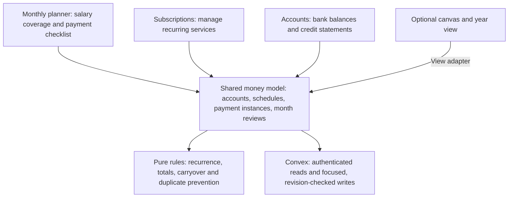

# Monthly money planner refactor

Status: implemented November 3, 2026. This document records the accepted product
plan; see the [technical guide](../technical/money-flow-canvas.md) for the resulting
architecture. Account balances remain manual; original canvas records are retained.

## What we are building

Make the selected month the main workspace. The key question is:

> Does my salary cover this month's expenses and savings?

The user confirmed that expenses plus savings should not exceed salary. They
also want leftover cash and unpaid bills carried between months, recurring
payments, a subscriptions page, and credit accounts for the Costco card and
Scotia Visa. For cards, they want balances/statement/due-date information and
the date they paid for that month, rather than individual purchase tracking.

The existing yearly forecast table becomes optional, behind a button. The
canvas remains an optional way to view account flows. Entering a bill, updating
an amount or marking a payment paid must work without opening it.

## Pages and navigation

Keep Money as the sidebar entry, with three main destinations:

| Page            | Main job                                                                                                                       |
| --------------- | ------------------------------------------------------------------------------------------------------------------------------ |
| Monthly planner | Salary, expenses, savings, payment dates, unpaid items and carryover for one selected month. This is the default page.         |
| Subscriptions   | Service/membership costs, billing frequency, next charge, payment account and active/cancelled status.                         |
| Accounts        | Bank and credit accounts. Credit details show monthly statements and Paid on dates; bank details can open the existing canvas. |

Manage ordinary recurring bills from the planner through **Manage recurring
payments**. Subscriptions get their own filtered management page, while sharing
the recurring-payment model. There is no need to enter the same subscription in
two places.

Proposed routes stay under `/dashboard/watchlist/money-flow`:

```text
/                              Monthly planner
/subscriptions                 Subscriptions
/accounts                      Bank and credit accounts
/accounts/[accountId]          Account details, including card statements
/[accountId]                   Existing canvas link, preserved
```

The optional **Year view** button reveals the broader table. It does not occupy
the default screen. The new monthly payment list is a different view from that
existing yearly forecast table.

## The monthly screen

Start with the current month and provide previous/next month controls. Show all
accounts together by default, with account and status filters when needed.

The screen has four sections:

1. **Salary and remaining allocation.** Salary, expenses/card payments, savings,
   and remaining salary. Show the amount over budget when the remainder is
   negative; use text as well as color.
2. **Carryover.** Confirmed money from the previous month and unpaid bills brought
   forward. Show the resulting amount available after commitments separately.
3. **Monthly payment list.** Editable rows grouped into income, bills, credit-card
   payments, savings/investments and carried unpaid items. A bill can expand into
   its individual payment dates.
4. **Month handoff.** Remaining unpaid items, confirmed cash to carry forward and
   the first upcoming payments next month. Do not require a year-long forecast
   to understand those obligations.

The initial row fields are name, amount, due date(s), payment account, status,
Paid on/completed date and notes. Support inline amount changes and a small
details panel. Do not force separate planned/actual amount columns into the
default list; users can correct the amount when the real bill arrives.

Payment status must not change a commitment into zero: a paid mortgage still
counts toward that month's expense allocation. Savings count toward salary
allocation too, although a transfer into savings is not consumption spending.

For variable or unconfirmed amounts, distinguish estimates from confirmed
amounts. An unknown amount is not zero. The uncertain subscription amount in
the screenshot should remain unconfirmed until entered deliberately.

### How the primary total works

Use a practical salary-allocation view for the first version:

```text
monthly commitments = direct bills + planned card repayments
                    + carried bills to pay + savings

remaining salary = salary - monthly commitments

remaining funds after commitments = remaining salary + confirmed carry-in cash
```

Warn whenever remaining salary is negative, even if carry-in cash covers it.
Extra cash should not hide that this month's commitments exceed salary.

These are allocation/cash-planning totals, not a claim to be a reconciled bank
balance or a complete purchase ledger. Keep labels explicit, especially if a
consumption-spending view is added later.

**Avoid counting card charges twice.** A subscription charged to Scotia Visa is
visible as a subscription and linked to that card. It does not also become a
second direct bank-cash expense on top of the card repayment. The repayment is
the cash commitment in the monthly salary check. Subscription-cost totals can
still show the service's cost, labelled separately from cash required this month.
Do not assume a charge belongs to the same month's statement/payment cycle.

Transfers between owned bank accounts count once in an all-account view.
Savings allocations count once; completing their transfer does not create a
second expense. Credit balances are liabilities, not available cash.

## Recurring payments and one-month changes

The screenshots include payment dates two weeks apart. We need actual payment
occurrences, not just one monthly amount and a start day.

Support one-off, weekly, every-two-weeks, twice-monthly, monthly and yearly
schedules. An every-two-weeks schedule uses an anchor date and 14-day intervals;
twice-monthly uses two dates each month. They are different: every-two-weeks can
produce three payments in a month.

Generate only the selected month and nearby dates needed by the planner. Store
each payment instance with a stable identity so loading a month twice does not
create duplicate bills. Rescheduling an instance keeps that identity.

Editing has explicit scope:

| Action                        | Meaning                                                          |
| ----------------------------- | ---------------------------------------------------------------- |
| Change this payment           | Adjust one occurrence's amount/date or skip it.                  |
| Change the recurring schedule | Change future occurrences from an effective date.                |
| Mark paid / completed         | Record the payment date; allow an amount correction if needed.   |
| Pause or cancel               | Stop applicable future occurrences while retaining past records. |

Keep paid/reviewed history when a recurring amount changes. The end date stays
optional. Preserve intentional zero amounts and skipped-payment semantics.

## Subscriptions

Each subscription uses the same recurring definition and monthly payment
instances as the planner. The subscriptions page adds service-specific context:
name/account label, cost, frequency, next billing date, payment account, notes
and active/paused/cancelled state.

Show the cost of active subscriptions and charges due in the selected month.
For yearly subscriptions, a monthly equivalent can be informational, but the
actual yearly charge appears on its billing date. Do not add both amounts to
monthly cash requirements.

Allow multiple subscriptions to the same provider: the two YouTube entries in
the screenshot may represent different accounts. Do not enforce unique service
names or infer whether an amount marked “x2” is per person or the combined total.

## Credit accounts

Add credit as an account category with its own balance meaning. Do not reuse a
chequing opening balance and merely relabel it as credit.

The initial credit view supports:

- Current balance and when it was last updated manually.
- Statement month, statement amount and payment due date.
- The planned payment amount and a **Paid on** date for that month's payment.
- The bank account used to pay and relevant notes.

The planner and card page edit the same monthly payment item. Marking the card
paid in one place updates the other. Preserve the statement month when payment
happens in the following calendar month; show when cash is actually due.

Use manual balances and payment confirmation initially. Do not infer a fresh
bank/card balance from a Paid on checkbox or promise individual card transaction
history. Multiple individual card payments and purchase categorization can be
added later if needed; they are not required for the first version.

## Carrying money and bills between months

Treat carry-in money and carried obligations as separate things. Closing a month
offers a suggested carry amount and lets the user confirm/correct it; an
unreviewed projection is not presented as confirmed cash. Money already moved
into savings is not automatically available to spend next month.

An unpaid bill appears next month with its original due date and month. It stays
the same obligation, not a newly created expense. Paying it from the later month
records one payment and updates its status everywhere. Show overdue amounts
separately from new bills so their origin remains clear.

If confirmed carry-in includes cash earmarked for unpaid bills, subtract that
obligation once when showing funds available. Do not first remove the reserve
from carry-in and then deduct the full bill again. Monthly commitment views can
surface an unpaid obligation until resolved; actual payment totals count its
settlement once, in the payment month.

Example with invented amounts: salary $6,000, direct bills/card payments $4,000,
savings $1,500 and carried unpaid bills $200 leave $300 of salary. Confirmed
carry-in of $400 makes remaining funds $700. An unpaid $200 item is not another
$200 payment simply because it appears in two months.

## Proposed architecture

Make financial records independent of canvas nodes. The pages share the same
accounts, recurring definitions and payment instances.



The model needs six concepts, with exact schema chosen during implementation:
financial accounts; recurring definitions (subscriptions are a kind); individual
monthly/due payment instances; salary and savings allocations; monthly review/
carryover records; and credit statements linked to their payment items.

Use small feature pages and focused hooks. Keep amount/date/recurrence rules
independent of React. Retain `Element` naming for canvas-specific components.
The monthly planner should not require `MoneyFlowWorkspace` or React Flow to load.

Reuse exact-cents parsing, date/month utilities, date pickers, shared form/save
feedback patterns, authentication, server ownership checks and existing canvas
components where their contracts fit. Extend calculation rules deliberately;
the current forecast alone cannot represent paid dates or fortnightly bills.

Planner writes should update an identified bill, payment or statement with
revision checks rather than save a stale whole-canvas snapshot. Keep the canvas
single-instance guard. Before enabling edits to the same records from multiple
pages, ensure canvas saves cannot overwrite planner changes; use shared commands
and revisions, and make unsupported canvas edits read-only during transition.

## Migration and existing data

Add new records and adapters alongside existing workspaces first. Preserve
account IDs, canvas layouts, labels, exact dates, monthly overrides and linked
transfers. Tag imported records with stable source IDs so a repeated conversion
cannot duplicate expenses.

Existing amounts are **monthly totals**. Do not reinterpret one as an amount due
every two weeks and accidentally multiply the commitment. Import it as a monthly
allocation until a per-payment amount and schedule are explicitly confirmed.
Existing forecast entries do not prove that anything was paid; leave payment
status unconfirmed. Do not copy screenshot amounts into live records as part of
the refactor without reviewing their meaning.

Keep old canvas links working. Move the bank-account list behind Accounts and
update Back to accounts/navigation accordingly. Once records have moved to the
shared model, use one authoritative edit path, not two independently editable
copies of the same bill.

## Build order

| Phase                               | Deliverable                                                                                                                                                                      | Done when                                                                                                       |
| ----------------------------------- | -------------------------------------------------------------------------------------------------------------------------------------------------------------------------------- | --------------------------------------------------------------------------------------------------------------- |
| 1. Shared model and monthly planner | Monthly landing page, salary/expense/savings allocation, direct row editing, manual one-off items, paid dates and optional year view. Preserve existing data through an adapter. | The user can replace their basic monthly spreadsheet workflow without opening the canvas.                       |
| 2. Recurrence and month handoff     | Real payment occurrences, one-payment overrides, every-two-weeks schedules, unpaid carryover and confirmed cash carry-in.                                                        | Two- and three-payment months calculate correctly; carrying a bill never creates a duplicate payment.           |
| 3. Credit accounts                  | Costco/Scotia card records, statements, payment due dates and monthly Paid on tracking linked to the planner.                                                                    | Updating Paid on from either page updates the same item; card payments and their charges are not counted twice. |
| 4. Subscriptions and optional views | Dedicated subscriptions page, shared recurrence editing and a canvas/year-view adapter for supported records.                                                                    | A subscription change reaches the appropriate future planner instances without rewriting paid history.          |

The implementation follows these phases with a shared record model, migration
adapter, monthly payment canvas and a dedicated technical guide.

## Acceptance checks

- Salary coverage includes savings and paid commitments; carry-in does not mask
  the over-salary warning.
- A recurring bill can have two or three due dates in a month. Editing one date
  does not change the series or paid history.
- An unpaid bill carried forward is one obligation with one eventual payment.
- Subscriptions paid by credit card and their card repayments do not both add
  the same charge to the cash-needed total.
- Savings transfers, linked account transfers, zero amounts, skipped payments
  and uncertain amounts retain their distinct meanings.
- A card statement for one month can be due/paid in the next; Paid on survives
  refresh and is consistent across planner and card pages.
- Existing accounts, historical data and canvas layouts survive migration;
  rerunning migration or occurrence generation cannot duplicate records.
- Failed saves retain edits, stale revisions cannot overwrite changes, and
  authenticated ownership is enforced on every private operation.
- The monthly page works on a phone and with keyboard input; canvas/year content
  loads only when requested.

Follow the repository's existing validation policy. The implementation adds no
dependencies or test infrastructure; focused verification uses isolated sample data.
