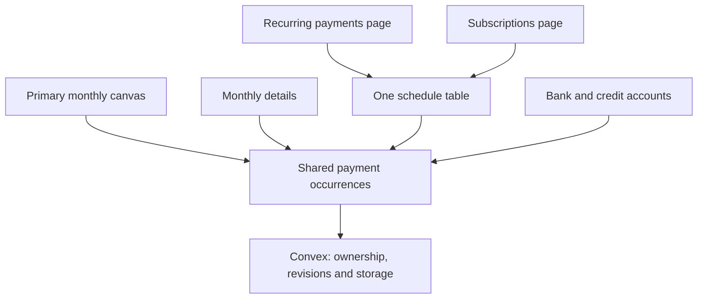

# Monthly money planner

Status: implemented November 3, updated November 9, 2026. The
[technical guide](../technical/money-flow-canvas.md) describes the running
architecture, modules and save flow.

## Accepted product decisions

The monthly canvas is the main Money UI. The key question is:

> Does my salary cover this month's expenses and savings?

Warn when expenses plus savings exceed salary. Confirmed cash from last month
must not hide that warning. The yearly forecast stays behind a button on the
secondary Monthly details page. Keep existing components and stored finance
records, including original canvas documents.

Canvas and detail pages share one navigation component and one budget summary.
Monthly details prioritizes scheduled payments; cash carryover, other schedules
and upcoming dates are collapsed until needed. Secondary setup/review/year-view
actions sit in a menu. Planner filters and editors reuse the existing shared
`Select` component instead of styling raw select fields independently.

November 9: the Money layout owns navigation and live month/account metadata
subscriptions. Switching pages keeps those mounted, avoiding repeated full-view
loading states. Clicking the current destination does nothing; other destinations
use prefetched client-side navigation. Initial loading and canvas lease checks
still apply. No separate browser finance cache is introduced.

The November 4 simplification removes manual **paid / received / completed**
controls throughout the canvas, monthly details and account pages. This replaces
the earlier completion-tracking proposal. Schedule activity (active, paused or
cancelled) remains because it controls future occurrences.

Recurring payments and subscriptions are separate product categories and pages,
but use the **same database table** and recurrence logic:

| Category          | Examples                                    | Page             | Stored schedule                                                  |
| ----------------- | ------------------------------------------- | ---------------- | ---------------------------------------------------------------- |
| Recurring payment | Mortgage, insurance, utilities, car payment | `/recurring`     | `moneyPlannerSeries`, `isSubscription: false`, `kind: "expense"` |
| Subscription      | YouTube Premium, ChatGPT, memberships       | `/subscriptions` | `moneyPlannerSeries`, `isSubscription: true`, `kind: "expense"`  |

There is no second subscription schedule table. Changing category updates the
same schedule. Salary, savings and transfer schedules remain manageable in
Monthly details. The canvas shows the month's shared payment occurrences.

## Pages and editing

All routes start with `/dashboard/watchlist/money-flow`.

| Route                   | Purpose                                                                            |
| ----------------------- | ---------------------------------------------------------------------------------- |
| `/`                     | Primary monthly canvas with account switching and salary summary.                  |
| `/[accountId]`          | Existing direct bank-account canvas URL.                                           |
| `/planner`              | Scheduled amounts, confirmed cash carryover and optional yearly table.             |
| `/recurring`            | Household bills, frequency, next date, account and active/paused/cancelled status. |
| `/subscriptions`        | Service and membership renewals, costs and billing accounts.                       |
| `/accounts`             | Bank and credit accounts with manual balances.                                     |
| `/accounts/[accountId]` | Account balance and scheduled payments; credit accounts also show statements.      |

Click a canvas element to edit its name, amount and scheduled date directly in
the inspector. Several occurrences in a month can be selected individually.
More details opens the existing shared payment editor. Edges are display-only.
Empty-space left dragging pans; the grid can be toggled from canvas controls.
On phones, swiping over cards also pans by default. **Move elements** switches
card dragging on; tapping still opens the editor and pinching zooms. Cards use
compact phone dimensions and wrap long content while retaining desktop sizing.

Camera saves wait until one second after gestures stop and skip unchanged
snapshots. Element moves save immediately. Normal layout saving stays quiet and
does not disable the month picker. Failed saves show Retry; failures and conflicts
block month changes until resolved. Pending camera state is flushed on hiding or
leaving the page when the canvas still has write permission; shutdown delivery
is best effort.

The canvas add toolbar provides income, expense, savings/transfer and credit-card
payment actions. Credit-card payments keep the selected bank as their funding
account and appear as expense elements. If needed, create the credit account
within that flow before entering its monthly payment. Existing shared toolbar
components and legacy consumers remain available.

The selected month is carried in `?month=YYYY-MM`. The main canvas account is
remembered with `?account=...`. Both pages for repeating expenses use the same
`ScheduleCollectionPage` and `ScheduleEditor`; their category filters keep them
separate without duplicating financial records.

## Monthly amounts and carryover

```text
commitments = scheduled direct bills + card repayments + savings
remaining salary = salary - commitments
remaining funds = remaining salary + confirmed carry-in cash
```

Only non-skipped occurrences assigned to the selected month appear in the
planner adapter. Historical pending rows are not automatically treated as unpaid
bills: without completion tracking, that state is not reliable evidence of debt.
If a bill belongs in another month, change that occurrence's scheduled date.
The record keeps its identity and is counted in its assigned month.

Cash carry-in and carry-out remain manually confirmed through month review.
There is no completion-based carry-out suggestion in the UI. Account balances
are manually recorded snapshots, not reconciled or automatically updated cash.

Amounts use integer CAD cents. Zero means an intentional $0 amount; a blank
amount means unknown. Unknown and estimated amounts keep totals provisional.
Internal transfers are excluded from all-account expenses. Savings count once.

A subscription charged to a credit card appears as a service cost on the
Subscriptions page. The bank cash commitment is its card repayment, avoiding a
double count. Credit balances are money owed, not spendable cash.

## Recurrence and changes

Support one-off, weekly, every-two-weeks, twice-monthly, monthly and yearly
schedules. Every-two-weeks advances 14 days from its anchor and can produce three
payments in a month. Twice-monthly uses two calendar-day slots. Short months
clamp to valid dates; end dates remain optional and inclusive.

Editing an occurrence changes only that payment. Editing the schedule creates
an effective-dated version for applicable future occurrences. Manual exceptions,
reviewed months and existing historical completion records remain protected.
Stable occurrence keys prevent duplicate generation when reopening a month.

Yearly subscription charges count in full on their scheduled date. A displayed
monthly equivalent is informational and must not become another payment.
Multiple subscriptions to the same provider are supported.

## Credit accounts

Costco Mastercard and Scotia Visa can have separate credit accounts. Each has a
manual balance and update date. A statement payment stores its statement month,
statement balance, scheduled repayment amount/date, source bank and destination
credit account. One card/statement month has one shared payment record.

The account page, monthly list and paying bank's expense element use that same
record. Statement month and scheduled payment month can differ. This version
does not include bank synchronization or individual card-purchase tracking.

## Architecture and preservation



Keep financial data independent of layout. Moving an element changes positions
and viewport only. Existing session ownership prevents two browsers from writing
the same canvas; record revisions protect financial edits against stale saves.

Existing source components and finance data are retained. Removing completion
controls requires no schema migration or backend deployment. Stored legacy
statuses and dates remain intact, and the old status-editor component stays in
source without being rendered by routed pages. The frontend adapter filters
legacy query results rather than deleting historical rows.

## Acceptance checks

- Canvas remains the default and supports direct element editing.
- Mortgage and subscriptions appear on their respective pages, backed by the
  same schedule table and shared editor.
- Category, amount, account and recurrence survive saving; failures preserve
  entered values and stale revisions cannot overwrite newer changes.
- No routed canvas, monthly or account view presents paid/received/completed
  controls or completion-based cash estimates.
- Salary coverage counts scheduled expenses and savings, including amounts with
  legacy completion history. Old pending rows do not accumulate across months.
- Card charges and repayments are not both counted as bank cash commitments.
- Existing history, original components, layouts and ownership checks remain.
- Verify phone/desktop layouts, keyboard use and existing project checks. Add no
  new test infrastructure or sample finance records to the user's database.
