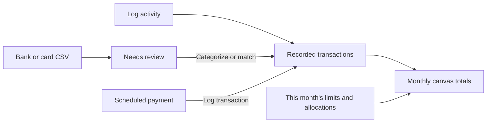
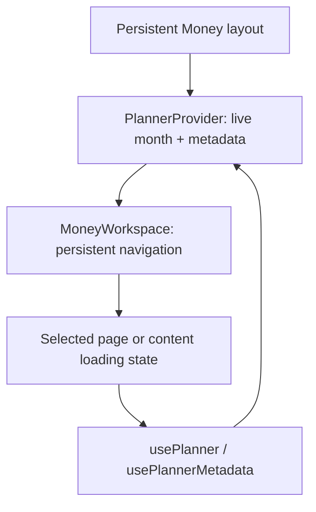
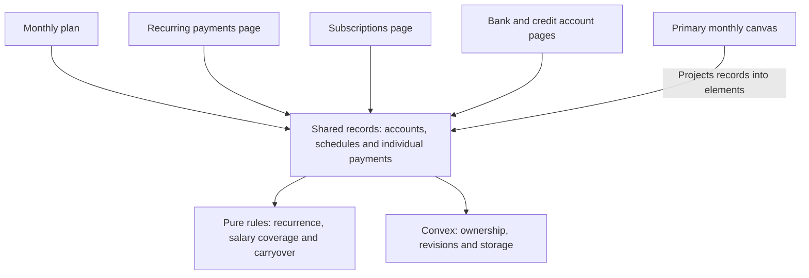
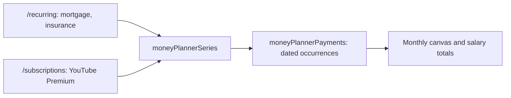
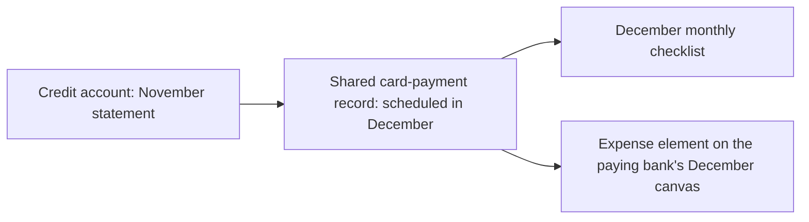
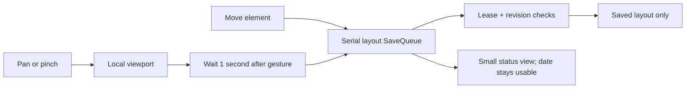

# How the monthly money planner works

Money opens to the selected bank workspace. The workspace switcher also offers
**All accounts** for combined activity across bank and credit accounts.
The header shows Income, Used and Net. **Used** opens the recorded expenses,
refunds and savings contributions included in that total. **Net** subtracts
Used from the Income shown. When Income falls back to scheduled pay, Net is
labeled with that basis. The scheduled canvas and **Monthly plan** retain cash
planning, with the yearly view in Monthly plan.

The overview places individual income cards, Expenses and Savings around the
selected bank. The workspace name and the selected month travel in the URL.
Bank workspaces show activity on that account. Card repayments paid from the
bank are available under **More → Upcoming payments**. Credit card purchases are included in the
combined workspace. The floating toolbar logs income,
expenses and savings directly from the canvas. Choose **Add element** to
name your own category or choose one from **Your categories** or **Common
categories** in the same picker. A fresh Expenses or Savings
canvas starts without preset category cards. A category appears when you add
it or record activity against it. Savings categories also appear when you set
aside a monthly amount. On Overview,
added categories connect to Expenses or Savings. Placement is saved with the
canvas layout.
Press Enter on a focused element to open it. Right-click or press Shift+F10
for quick actions.
**Remove from canvas…** appears in the menu and the category editor. It removes
the category card from that workspace and keeps its monthly amounts and
transactions. Use **Add element** to restore it.
**Expenses** opens a canvas with spending categories and recurring payments.
**All accounts** also shows spending by bank account and credit card. In a
bank workspace, the selected bank appears on Overview and its purchases
remain in the Expenses total and transaction list.
Account and category cards show recorded spending. **Accounts** shows card
balances and statement payments. Each recurring bill or subscription has one
Expenses card for the selected month's occurrences. A bank workspace includes
recurring charges on the credit cards it pays that month. Click a recurring
card to see each scheduled charge or its linked recorded transaction. Scheduled
amounts stay separate from the recorded spending total.
**Hide card…** in an account card's menu or activity panel
removes the card from Expenses and keeps the account, its activity and monthly
totals. Use **Add element → Restore hidden cards** in Expenses to restore an
account or recurring payment card.
Choose **View transactions** in Expenses or Savings to see that month's
transactions even when the cards are hidden. **Used** shows expenses and
savings together and breaks down its total above the recorded transactions.
The activity sheet stays open when you open a transaction or confirm a
deletion. Returning to the list keeps its tab, account filter and scroll position.
Click an account to see its transactions and scheduled charges. Click a recorded expense to
change its category tag, or create a category such as **Groceries (necessity)**
under **More → Monthly amounts**. To delete an individual transaction, choose
**View transactions** and use **Delete** next to the entry. The confirmation
shows the amount and date. Deleting an entry updates the monthly totals and
returns any matched import to **Needs review**. **Savings** opens the savings categories.
**More → Transfers** lists bank transfers and card repayments.

Each view restores its camera when you return during the session. Bank
workspaces save their positions and card visibility under separate keys in the
activity layout. The combined overview keeps its saved camera and existing
positions. A reserved layout key records each hidden card, so restoring one
also recovers its previous position.

This guide describes the running architecture. The
[refactor plan](../plans/monthly-money-planner.md) records the product decisions;
the [Convex integration record](../plans/money-flow-convex-integration.md) covers
authentication and deployment configuration.

## Record what happened

Use **Log expense** or **Log savings** on the toolbar for purchases, tithes,
e-transfers and contributions.
Choose the account, posted date, amount and category. **Log income**
on the toolbar records money received. Clicking a category on the canvas opens its recorded
activity and amount set aside. **More → Monthly amounts** sets the optional
overall spending limit or a category amount. Category names carry across months;
each month owns its amounts.

Each receipt or scheduled income occurrence has its own card. Use **Log
income** for a paycheque, gift or other receipt and choose the receiving bank.
Click a card to edit that entry. The Income total uses scheduled pay when
there are no receipts. **Delete scheduled income…** skips the selected occurrence and keeps
future occurrences scheduled. Use **Log as received** when the money arrives. The unallocated
income calculation uses recorded receipts.

| Transaction                                                  | Effect on the activity overview                                           |
| ------------------------------------------------------------ | ------------------------------------------------------------------------- |
| Card or debit purchase, including a tithe sent by e-transfer | Adds to the spending category in the posted month.                        |
| Refund                                                       | Reduces spending in the selected expense category.                        |
| TFSA contribution                                            | Adds to savings contributed and uses that category's allocation.          |
| Card repayment or transfer between bank accounts             | Records the movement between accounts. Spending was recorded at purchase. |

```text
unallocated = recorded income - net spending - savings contributed
              - remaining category allocations
spending limit remaining = optional monthly spending limit - net spending
```

The scheduled outflow total is a separate view of recorded plans. In **Scheduled
payments**, **Log transaction** uses the payment as a starting point, with a
posted date and actual amount. Imported and manual entries can also be linked
from their editor. Linked occurrences leave the list of scheduled items still
to record. Account balances are the manual snapshots from Accounts, with
balance dates on the account pages.

### Review bank and card activity

Choose **More → Import CSV** for a single account. The CSV needs Date,
Description and Amount columns, YYYY-MM-DD dates, and signed CAD amounts. Pick
the sign used for money out and verify the preview. The import includes up to
500 rows from the selected month and reports rows from other months. Review each
imported row to categorize and log it, match a transaction already recorded
with the same account side, date and amount, or ignore it. An imported row
affects spending after it is logged. Both sides of a transfer can match the
same recorded transaction. Repeat imports with the same row values and
occurrence counts are skipped.

**Reviewed through** is a date you confirm after checking your accounts. A new
unreviewed import on or before that date clears the confirmation. The app
supports manual entry and CSV review.



`plannerActivity` owns the activity mutations. The additive
`moneyActivityEntries`, `moneyActivityMonths`, `moneyActivityCategories` and
`moneyActivityImports` tables preserve existing plans, statements and account
records. Existing scheduled amounts remain in the plan. Actual totals start
with transactions you record. Activity positions use their own layout under the
existing canvas lease. The activity and scheduled canvases share
`PlannerCanvasFrame` for panning, zoom, selection and layout persistence.

## Start with the pages

All paths below start with `/dashboard/watchlist/money-flow`.

| Path                    | What the page does                                                                                                  |
| ----------------------- | ------------------------------------------------------------------------------------------------------------------- |
| `/`                     | Monthly activity canvas across all accounts, with spending and allocations.                                         |
| `/upcoming`             | Scheduled bank canvas with account switching and salary coverage.                                                   |
| `/planner`              | Scheduled monthly amounts, confirmed cash carryover and optional year view.                                         |
| `/recurring`            | Manage household bills such as mortgage, insurance and car payments.                                                |
| `/subscriptions`        | Manage recurring services and memberships, including multiple subscriptions to the same provider.                   |
| `/accounts`             | List bank and credit accounts, keeping cash and money owed separate.                                                |
| `/accounts/[accountId]` | Update a manually recorded balance and review payments. Credit accounts show statement amounts and scheduled dates. |
| `/[accountId]`          | Monthly canvas for a bank account. Existing canvas URLs still work.                                                 |

The month is kept in the URL as `?month=YYYY-MM`; without a selection, the planner
uses the browser's current month. Page navigation preserves the selected month
where supplied. The server checks supported dates independently.

The Money route has a persistent `layout.tsx`. It mounts `PlannerProvider` and
`MoneyWorkspace` once, above the individual pages and their loading boundaries.
`MoneyWorkspace` owns `MoneyNavigation`: wide layouts show tabs; narrow layouts
show the current page with a navigation dropdown. The selected page comes from
the pathname. Account details belongs to the canvas account toolbar.

`PlannerProvider` keeps the selected month's live Convex subscription and bank
metadata subscriptions active while moving between Money pages. `usePlanner`
and `usePlannerMetadata` read that context instead of starting page-owned copies.
The provider waits for an explicit `ready: false` query result before initializing
a month. Loading query data alone does not start a mutation.

Navigation uses Next.js client links with full-route prefetching in production.
Clicking the current top-level destination is a no-op; links from nested account
pages still return to the account list. Browser Back/Forward and month links keep
working. A cold route can show a small content-only loading state while the nav
remains mounted. First visits still need route code and initial data; localhost
development mode does not perform Next.js automatic link prefetching.

The provider is scoped to this route layout, with no module/global finance cache
or local-storage copy. Leaving Money tears down its subscriptions. The canvas
editor still unmounts when leaving its page and checks its server lease again on
return; keeping reads warm must not keep an inactive editor's write permission.



`MonthlyBudgetSummary` presents the same income, expenses, savings and remaining
amounts in both views. The canvas and monthly wrappers supply the same calculation
and use `className` to fit their surroundings. The summary includes all accounts;
the payment-list account filter only filters rows.

Monthly plan keeps the payment list visible. Cash carryover, salary/savings
schedules and next month's dates are collapsed disclosures. Less frequent actions
(salary setup, review and the optional year view) live in the actions menu.

Planner filters and editors reuse the existing Radix `Select` primitive from
`src/components/ui/select.tsx`, also used by bank setup. Form selections use
`Select`; navigation and action menus use the existing `DropdownMenu` components.
Neither shared primitive imports Money routes or financial data.

`ScheduleCollectionPage` owns the category filter and editor state;
`ScheduleCollectionList` renders the rows and their next scheduled dates. Their
props are read-only. Independent database operations run in awaited batches;
save queues and browser-import batches use ordered asynchronous continuations
so a lint cleanup cannot make revision-dependent writes concurrent.



The monthly details page at `/planner` does not need React Flow to load. The
yearly table is dynamically loaded only when opened. `CanvasHomePage` selects a
bank account and reuses `PlannerCanvasPage`, which also serves the existing
account canvas URLs. The bank choice is remembered in the scheduled canvas URL as
`?account=...`; changing the month keeps the account's canvas session mounted.

Clicking an element opens `CanvasPaymentForm` directly on the canvas: name,
amount and payment date. Several occurrences can be selected by date in that
same inspector. Desktop uses a nonmodal side panel; mobile uses a bottom sheet.
More details reuses the existing payment editor. Completion controls are removed. The
original canvas/workspace components remain in the codebase. `AccountSwitcher`,
`MoneyElement`, `CanvasInspector`, `CanvasGridBackground` and `CanvasViewControls`
are shared by the canvases and live in the feature's top-level `components`
folder. Shared route, amount and formatting helpers live at the feature root.
Restoring loaded positions affects layout only.

Both connection renderers reuse `ElementConnectionPath`: a static line and end
arrow show direction, with small moving arrowheads travelling from source to
target and rotating around bends. The background, drag snapping and connection
routes share the 24-pixel grid in graph coordinates. Connected cards are drawn
with their vertical midpoints on the nearest grid row. The handles stay centered
and the connections use that same row. The final segment
is straight for the fixed arrow, and moving arrowheads fade before reaching it.
The line, end arrow and moving arrowheads share
the element's palette: emerald for income, rose for expenses (including card
repayments), and sky blue for savings/transfers. These colors come from
`ELEMENT_PRESENTATION`, alongside the card/handle styles. The monthly projection
supplies the element kind; the original renderer reads the connected nodes.
Arrowheads fade at each end, keeping the solid connection easy to follow. Salary
flows into the bank; outgoing expenses, savings and card payments flow toward
their elements. CSS motion paths animate without React state or layout saves. OS reduced
motion and the app's Reduce motion preference keep the direction cue visible at
an eight-second cycle instead of the normal three seconds. This
connection-specific exception overrides the global motion reset; other motion
preferences remain unchanged. Connections remain display-only.

To tweak connections, edit
`src/features/money-flow/components/element-connection-config.ts`. This one config
controls both canvas renderers: travel time, arrow count/size/stroke, line
thickness, opacity, end-arrow size and colors. Durations are in seconds (lower is
faster), sizes use graph coordinates and opacity runs from 0 to 1. Changing the
arrow count spaces them evenly; use 0 for a solid line with only its end arrow.
Keep durations positive and arrow count a nonnegative whole number.

```ts
// Example tweaks inside ELEMENT_CONNECTION_CONFIG:
durationSeconds: 2,              // faster arrows
reducedMotionDurationSeconds: 5, // still visible with Reduce motion
arrowCount: 3,                   // three evenly spaced arrowheads
arrowSize: 10,                   // larger arrowheads
lineWidth: 2,                    // thicker connection
```

On phones, a one-finger swipe over empty space or a card pans the canvas. Tap a
card to edit it; enable **Move elements** in the add toolbar to drag cards instead.
Pinch zoom remains available. Desktop keeps direct card dragging and empty-space
panning. Phone cards use smaller widths and spacing, with wrapping labels and
amounts. React Flow measures their rendered sizes and updates connections when
the viewport crosses a layout breakpoint; zoom scales the whole graph.

The scheduled canvas reuses `ElementToolbar` for income, expense and savings/transfer
creation. Its `tools` prop chooses the applicable tools, and its children slot adds
a credit-card button. Legacy consumers retain the default tools, drag behavior
and optional selection actions. The monthly canvas uses click creation because
records must be saved before they become graph elements.

`CanvasElementEditor` presets the selected bank and requested payment type.
The credit-card action creates `kind: "cardPayment"`, with the bank as source,
the chosen credit account as destination and the selected statement month. One
existing card is selected automatically; with several cards, the user chooses.
If no credit account exists, `AccountEditor` creates one with a fixed credit kind
and returns its database ID through `onSaved`. The flow waits for the live account
query to supply its domain ID before mounting the payment form. The saved payment
then appears as an expense element on the paying bank's canvas.

Changing a payment type retains an eligible funding account. A purchase charged
directly to a card remains separate from the bank-to-card repayment, preventing
the same cost from being counted twice in cash allocations.

## The three important records

A **schedule** describes what repeats. A **payment** is one occurrence of that
schedule, or a one-off item. A **monthly review** records confirmed carryover and
whether the month's plan has been reviewed.

For example, a mortgage paid every two weeks has one recurring definition but
two or three individual payment records in a month. Editing one occurrence
does not change the entire series.

| Table                  | Responsibility                                                                                                                                                                       |
| ---------------------- | ------------------------------------------------------------------------------------------------------------------------------------------------------------------------------------ |
| `moneyPlannerSettings` | Tracking start month, migration marker and recurring-schedule revision.                                                                                                              |
| `moneyPlannerAccounts` | Bank/credit account metadata, manual balance, last update and account revision.                                                                                                      |
| `moneyPlannerSeries`   | Effective-dated schedule versions. Subscriptions are schedules with `isSubscription`.                                                                                                |
| `moneyPlannerPayments` | Amount, scheduled date, account and revision; legacy completion fields are retained but no longer edited in the UI. Card statements are linked payment records, not a separate copy. |
| `moneyPlannerMonths`   | Confirmed carry-in/out, reviewed status and generation revision.                                                                                                                     |
| `moneyPlannerLayouts`  | Canvas positions, pan/zoom and layout revision. No financial amounts.                                                                                                                |

Every row belongs to the authenticated user. Account references use stable domain
IDs so existing account links survive migration. Server mutations validate that
referenced accounts belong to the user too.


These are logical relationships. A payment can be unassigned to an account or be
a one-off with no schedule. Several fields, including amounts and dates shown in
the diagram, can be null.

## Follow a month opening

The persistent provider uses
[`usePlannerState`](../../src/features/money-flow/planner/use-planner.ts) to
subscribe to `moneyPlanner.getMonth`. If the month needs initialization or
regenerated schedules, it calls `moneyPlanner.openMonth`. Pages consume the
result through `usePlanner`; changing pages does not restart that subscription.

On the first opening, one transaction creates settings and imports the existing
plan. Later openings generate only missing payments or eligible pending updates
for that month. An occurrence key identifies the original schedule/date, so
opening the same month twice cannot create two copies. A rescheduled occurrence
keeps its original key even if its due date moves into another month.

The server's existing `getMonth` query also returns historical pending and
settled rows for compatibility. The `usePlanner` adapter exposes only non-skipped
entries assigned to the selected month. Without completion tracking, an old
pending record is not evidence of an unpaid debt. Moving a payment's scheduled
date into another month moves the same record; it does not clone the bill.

## How the salary check works

The first version is a salary-allocation and cash-planning view:

```text
commitments = direct bills + card repayments + savings scheduled this month
remaining salary = salary - commitments
remaining funds = remaining salary + confirmed carry-in cash
```

Scheduled commitments count toward the allocation regardless of legacy completion status. Carry-in cash is displayed
separately and never suppresses an over-salary warning. Internal bank transfers
are excluded from the all-account commitment total. Savings are counted once as
an allocation, rather than twice as an allocation and a transfer.

The screen uses the pure calculation function in
[`totals.ts`](../../src/features/money-flow/planner/totals.ts):

```ts
const totals = plannerTotals(
  data.entries,
  data.accounts,
  month,
  data.carryInCents,
  data.settlements
);

// totals.remaining: salary after expenses and savings
// totals.available: includes confirmed carry-in; null when it is unconfirmed
// totals.unknown: amounts still unknown, rather than zero
```

Amounts are integer cents in CAD. A payment amount of `0` means an intentional
zero; a payment amount of `null` means unknown. Unknown and estimated amounts
make totals provisional. In imported **month overrides**, `null` has a different
legacy meaning: skip that month's scheduled payment.

The UI does not track **paid**, **received** or **completed** states. The former
`PaymentStatusEditor`, status-label helper, backend mutation and stored history
are retained for compatibility, but routed pages do not render completion controls.
Balances remain manual snapshots. Carry-out is manually confirmed; the review
no longer offers a calculation based on completion dates.

## Separate categories, one schedule table

Recurring household payments and subscriptions have separate management pages.
Both use `ScheduleCollectionPage` and `ScheduleEditor`, backed by the existing
`moneyPlannerSeries` table. A category change edits the same schedule rather
than creating another record. Salary, savings and transfer schedules stay in
Monthly plan.

```ts
// The same schedule rows power both pages.
const recurringPayments = schedules.filter(
  (item) => item.kind === "expense" && !item.isSubscription
);
const subscriptions = schedules.filter(
  (item) => item.kind === "expense" && item.isSubscription
);
```



The boolean `isSubscription` is the category discriminator; there is no separate
subscription schedule table or migration. Active/paused/cancelled refers to the
schedule's future activity, not whether an occurrence was paid.

## Credit cards and subscriptions share payment records

A subscription paid from a bank account is a direct cash commitment. A
subscription charged to a credit card is shown as a service cost, but is excluded
from that direct-cash total. The card repayment is the cash commitment instead.
Adding both would count the same charge twice.

A card statement is a payment with `kind: "cardPayment"`, a statement month,
statement balance, due date, planned repayment amount, source bank account and
destination credit account. There is one payment record per card/statement
month. The statement month and due/payment months can differ.



Editing the amount or scheduled date from either page updates that record.
In the Accounts table, enter the planned payment amount and choose **Save**.
Older card payments use their displayed month if a statement month was never
stored.
Account details show the selected statement month first. **Other statements**
keeps the remaining recent payments available for editing.
[`canvas-projection.ts`](../../src/features/money-flow/planner/canvas-projection.ts)
groups the bank's monthly payments into display elements. Credit repayments use
an expense element. Several occurrences of one recurring schedule share one
element, whose inspector lists the individual payments.

The source record keeps the credit meaning; the canvas type controls appearance:

```ts
const kind = income
  ? "income"
  : first.kind === "savings" || first.kind === "transfer"
    ? "account"
    : "expense"; // Includes cardPayment.
```

Yearly subscription costs appear in full on the billing date. Their monthly
equivalent is informational and is not added as another monthly payment.

## Recurrence and history

[`recurrence.ts`](../../src/features/money-flow/planner/recurrence.ts) uses calendar
dates with UTC fields, avoiding daylight-saving shifts. It supports one-off,
weekly, every-two-weeks, twice-monthly, monthly and yearly schedules.

Every-two-weeks advances by 14 days from an anchor date; it can create three
payments in one month. Twice-monthly uses two calendar-day slots. Short months
clamp dates to the last valid day; two slots remain two payments even if both
clamp to the same date. End dates are optional and inclusive.

Editing one payment updates only that record and marks it as a manual exception.
Editing a recurring schedule creates an effective-dated version. Generation
preserves paid items, manual exceptions and reviewed months. Timing changes with
unresolved custom upcoming payments require those exceptions to be resolved
first, preventing accidental duplicate obligations.

## Follow an edit from screen to server

```mermaid
sequenceDiagram
    actor User
    participant Form as Payment editor or inline amount
    participant API as plannerPayments.save
    participant DB as Convex database
    participant Views as Planner, account page and canvas

    User->>Form: Save an amount or scheduled date
    Form->>API: Payment ID, expected revision and changes
    API->>DB: Check owner, references and current revision
    alt Request came from a canvas
        API->>DB: Check active canvas session too
    end
    alt Revision is current and data is valid
        API->>DB: Update the payment and increment revision
        DB-->>Views: Live query updates
        API-->>Form: Confirm saved
    else Conflict or failure
        API-->>Form: Error; retain entered values
    end
```

Forms prevent duplicate submissions and retain values after failures. Inline
amount edits remember the revision at the start of editing. An old window cannot
silently overwrite a newer payment revision. The phone layout shows payment
cards; wider layouts show a table with inline amounts.

Canvas financial edits use the same payment mutations. Layout writes use a
separate serial `SaveQueue`, so moving a card cannot overwrite a financial record.
`usePlannerLayout` owns that queue and the latest positions. Camera gestures stay
local until one second after the last gesture; another gesture restarts the wait.
Unchanged snapshots are skipped. Moving an element saves immediately, and view
control buttons capture their final viewport. Pending camera saves are flushed
when the page becomes hidden or unmounts, while write permission is still valid.
Browser shutdown delivery is best effort.

The canvas itself does not subscribe to save progress. `CanvasLayoutStatus`
isolates queue updates and keeps normal saving quiet. `CanvasMonthPicker`
subscribes only to the failed/conflict flag, so panning does not disable or
re-render the date control. Failures retain the draft and show a retry action;
conflicts require refreshing. Both block month changes until resolved.



The event wiring separates camera persistence from element edits:

```tsx
onMoveStart={persistence.cancelTimer}
onMoveEnd={(event) => {
  if (event) persistence.captureViewport();
}}
onNodeDragStop={(_, node) => persistence.moveElement(node)}
```

The existing 90-second canvas lease renews every 20 seconds. A normally opened
second canvas is blocked; refresh or the explicit takeover button requests
control. The button requests takeover directly, with a pending state. Server
guards reject writes from displaced canvas sessions. Ordinary planner/account
pages use record revisions and do not acquire the canvas layout lock.

## Migration and the original canvas

The initial import copies existing accounts and schedules with stable source
identities and preserves monthly totals, exact dates, zero/skipped overrides and
linked transfers. Incoming counterparts are not mistaken for additional salary.
Original workspace documents remain intact as recovery sources. Imported bank
balances are labelled unverified opening balances; forecast entries are not
proof that payments were made.

The scheduled canvas projects shared monthly payments. Stored original positions
are reused where the imported schedules correspond to old elements. Notes and
other original graph details remain in the preserved original workspace records.
Changing payment dates/amounts no longer writes an independent copy of finances
inside that old graph.

After migration, legacy full-workspace saves, scenario changes and replacement
imports are rejected. Bank creation from the new accounts API also creates the
legacy bank identity needed by existing canvas URLs and session guards, in the
same transaction. No finance records are seeded from screenshots or demo data.

## Where to change things

Feature paths below are relative to `src/features/money-flow/planner/`.

| Change                                   | Start here                                                                                                          |
| ---------------------------------------- | ------------------------------------------------------------------------------------------------------------------- |
| Monthly composition and filters          | `components/monthly-planner-page.tsx`                                                                               |
| Shared page navigation                   | `components/money-navigation.tsx`, `planner-shell.tsx`, `planner-canvas-page.tsx`                                   |
| Shared budget summary                    | `components/monthly-budget-summary.tsx`, `monthly-salary-summary.tsx`, `canvas-budget-summary.tsx`, `totals.ts`     |
| Month loading/navigation                 | `use-planner.ts`, `use-planner-month.ts`, `convex/moneyPlanner.ts`                                                  |
| Payment fields and scheduled amounts     | `components/payment-editor.tsx`, `payment-fields.tsx`, `payment-list.tsx`                                           |
| Recurring schedules                      | `recurrence.ts`, `components/schedule-editor.tsx`, `convex/plannerSchedules.ts`                                     |
| Recurring payment and subscription pages | `components/schedule-collection-page.tsx`, `subscriptions-page.tsx`                                                 |
| Accounts and statements                  | `components/accounts-page.tsx`, `account-details-page.tsx`, `account-editor.tsx`, `convex/plannerAccounts.ts`       |
| Carryover/review                         | `components/month-review-editor.tsx`, `convex/moneyPlanner.ts`                                                      |
| Canvas elements and layout               | `canvas-projection.ts`, `components/planner-canvas.tsx`, `planner-element-inspector.tsx`, `convex/plannerCanvas.ts` |
| Camera persistence and save feedback     | `use-planner-layout.ts`, `components/canvas-layout-status.tsx`                                                      |
| Optional year view                       | `components/year-view.tsx`, `convex/plannerYear.ts`                                                                 |
| Schema, validation and migration         | `convex/plannerSchema.ts`, `convex/lib/planner.ts`, `convex/lib/plannerMigration.ts`                                |

Shared buttons, sheets and date pickers remain in `src/components/ui/`. The
previous `components/workspace/` editor remains available in source for reference
but is no longer the routed monthly UI. Generated Convex API files are generated
by tooling, not hand-edited.

The backend is the configured Personal Dashboard Convex deployment, shared by
localhost and hosting. The personal-site database is separate. There is no bank
synchronization or individual credit-card purchase ledger in this version.
