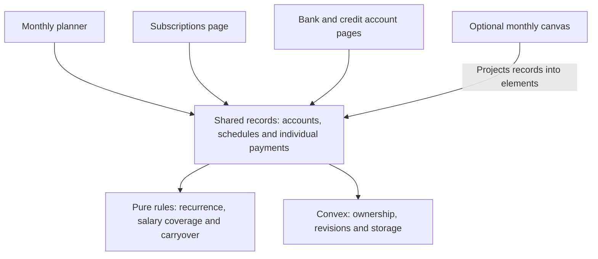
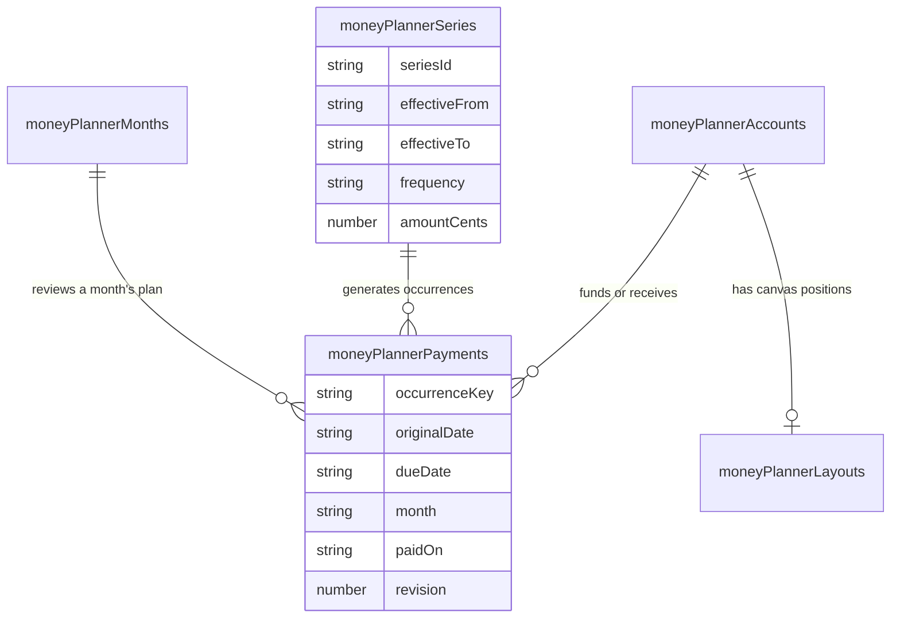
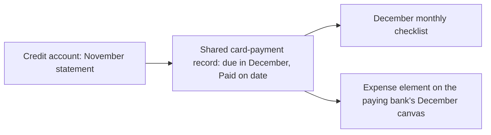

# How the monthly money planner works

Money opens to one month. Its main question is **does salary cover expenses and
savings?** Subscriptions and accounts have their own pages. The canvas and yearly
table are optional views of the same financial records.

This guide describes the running architecture. The
[refactor plan](../plans/monthly-money-planner.md) records the product decisions;
the [Convex integration record](../plans/money-flow-convex-integration.md) covers
authentication and deployment configuration.

## Start with the pages

All paths below start with `/dashboard/watchlist/money-flow`.

| Path                    | What the page does                                                                                         |
| ----------------------- | ---------------------------------------------------------------------------------------------------------- |
| `/`                     | Selected month's salary, expenses, savings, payment checklist and carryover. Year view is behind a button. |
| `/subscriptions`        | Manage recurring services and memberships, including multiple subscriptions to the same provider.          |
| `/accounts`             | List bank and credit accounts, keeping cash and money owed separate.                                       |
| `/accounts/[accountId]` | Update a manually recorded balance and review payments. Credit accounts show statements and Paid on dates. |
| `/[accountId]`          | Monthly canvas for a bank account. Existing canvas URLs still work.                                        |

The month is kept in the URL as `?month=YYYY-MM`; without a selection, the planner
uses the browser's current month. Page navigation preserves the selected month
where supplied. The server checks supported dates independently.



The planner does not need React Flow to load. The yearly table is dynamically
loaded only when opened. Canvas code belongs to its account route.

## The three important records

A **schedule** describes what repeats. A **payment** is one occurrence of that
schedule, or a one-off item. A **monthly review** records confirmed carryover and
whether the month's plan has been reviewed.

For example, a mortgage paid every two weeks has one recurring definition but
two or three individual payment records in a month. Marking one payment paid
does not mark the whole series paid.

| Table                  | Responsibility                                                                                                                                          |
| ---------------------- | ------------------------------------------------------------------------------------------------------------------------------------------------------- |
| `moneyPlannerSettings` | Tracking start month, migration marker and recurring-schedule revision.                                                                                 |
| `moneyPlannerAccounts` | Bank/credit account metadata, manual balance, last update and account revision.                                                                         |
| `moneyPlannerSeries`   | Effective-dated schedule versions. Subscriptions are schedules with `isSubscription`.                                                                   |
| `moneyPlannerPayments` | Amount, due date, payment account, status, Paid on date and revision for each payment. Card statements are linked payment records, not a separate copy. |
| `moneyPlannerMonths`   | Confirmed carry-in/out, reviewed status and generation revision.                                                                                        |
| `moneyPlannerLayouts`  | Canvas positions, pan/zoom and layout revision. No financial amounts.                                                                                   |

Every row belongs to the authenticated user. Account references use stable domain
IDs so existing account links survive migration. Server mutations validate that
referenced accounts belong to the user too.



These are logical relationships. A payment can be unassigned to an account or be
a one-off with no schedule. Several fields, including amounts and dates shown in
the diagram, can be null.

## Follow a month opening

[`usePlanner`](../../src/features/money-flow/planner/use-planner.ts) subscribes to
`moneyPlanner.getMonth`. If the month needs initialization or regenerated
schedules, it calls `moneyPlanner.openMonth`.

On the first opening, one transaction creates settings and imports the existing
plan. Later openings generate only missing payments or eligible pending updates
for that month. An occurrence key identifies the original schedule/date, so
opening the same month twice cannot create two copies. A rescheduled occurrence
keeps its original key even if its due date moves into another month.

`getMonth` combines the selected month's payments, eligible older unpaid bills,
older bills settled during this month, the monthly review and upcoming dates.
An old bill appears as the same record; carrying it forward does not clone it.
Forecast-only records before the tracking start are not assumed to be unpaid debt.

## How the salary check works

The first version is a salary-allocation and cash-planning view:

```text
commitments = direct bills + card repayments + carried bills + savings
remaining salary = salary - commitments
remaining funds = remaining salary + confirmed carry-in cash
```

Paid commitments still count toward the allocation. Carry-in cash is displayed
separately and never suppresses an over-salary warning. Internal bank transfers
are excluded from the all-account commitment total. Savings are counted once as
an allocation, rather than twice as an allocation and a transfer.

The screen uses the pure calculation function in
[`totals.ts`](../../src/features/money-flow/planner/totals.ts):

```ts
const totals = plannerTotals(
  data.entries,
  data.accounts,
  month,
  data.carryInCents,
  data.settlements
);

// totals.remaining: salary after expenses and savings
// totals.available: includes confirmed carry-in; null when it is unconfirmed
// totals.unknown: amounts still unknown, rather than zero
```

Amounts are integer cents in CAD. A payment amount of `0` means an intentional
zero; a payment amount of `null` means unknown. Unknown and estimated amounts
make totals provisional. In imported **month overrides**, `null` has a different
legacy meaning: skip that month's scheduled payment.

These figures are not a reconciled bank balance. Account balances are manual
snapshots; setting a Paid on date does not automatically change them. Carry-out
can use a calculated suggestion, but the user confirms it before it becomes
next month's carry-in. Cash reserved for an unpaid bill is deducted once when
showing funds after commitments.

## Credit cards and subscriptions share payment records

A subscription paid from a bank account is a direct cash commitment. A
subscription charged to a credit card is shown as a service cost, but is excluded
from that direct-cash total. The card repayment is the cash commitment instead.
Adding both would count the same charge twice.

A card statement is a payment with `kind: "cardPayment"`, a statement month,
statement balance, due date, planned repayment amount, source bank account and
destination credit account. There is one payment record per card/statement
month. The statement month and due/payment months can differ.



Editing the amount or Paid on date from either page updates that record.
[`canvas-projection.ts`](../../src/features/money-flow/planner/canvas-projection.ts)
groups the bank's monthly payments into display elements. Credit repayments use
an expense element. Several occurrences of one recurring schedule share one
element, whose inspector lists the individual payments.

The source record keeps the credit meaning; the canvas type controls appearance:

```ts
const kind = income
  ? "income"
  : first.kind === "savings" || first.kind === "transfer"
    ? "account"
    : "expense"; // Includes cardPayment.
```

Yearly subscription costs appear in full on the billing date. Their monthly
equivalent is informational and is not added as another monthly payment.

## Recurrence and history

[`recurrence.ts`](../../src/features/money-flow/planner/recurrence.ts) uses calendar
dates with UTC fields, avoiding daylight-saving shifts. It supports one-off,
weekly, every-two-weeks, twice-monthly, monthly and yearly schedules.

Every-two-weeks advances by 14 days from an anchor date; it can create three
payments in one month. Twice-monthly uses two calendar-day slots. Short months
clamp dates to the last valid day; two slots remain two payments even if both
clamp to the same date. End dates are optional and inclusive.

Editing one payment updates only that record and marks it as a manual exception.
Editing a recurring schedule creates an effective-dated version. Generation
preserves paid items, manual exceptions and reviewed months. Timing changes with
unresolved custom upcoming payments require those exceptions to be resolved
first, preventing accidental duplicate obligations.

## Follow an edit from screen to server

```mermaid
sequenceDiagram
    actor User
    participant Form as Payment editor or inline amount
    participant API as plannerPayments.save / setStatus
    participant DB as Convex database
    participant Views as Planner, account page and canvas

    User->>Form: Save an amount or Paid on date
    Form->>API: Payment ID, expected revision and changes
    API->>DB: Check owner, references and current revision
    alt Request came from a canvas
        API->>DB: Check active canvas session too
    end
    alt Revision is current and data is valid
        API->>DB: Update the payment and increment revision
        DB-->>Views: Live query updates
        API-->>Form: Confirm saved
    else Conflict or failure
        API-->>Form: Error; retain entered values
    end
```

Forms prevent duplicate submissions and retain values after failures. Inline
amount edits remember the revision at the start of editing. An old window cannot
silently overwrite a newer payment revision. The phone layout shows payment
cards; wider layouts show a table with inline amounts.

Canvas financial edits use the same payment mutations. Layout writes use a
separate serial `SaveQueue`, so moving a card cannot overwrite a financial record.
The existing 90-second canvas lease renews every 20 seconds. A normally opened
second canvas is blocked; refresh or the explicit takeover button requests
control. The button requests takeover directly, with a pending state. Server
guards reject writes from displaced canvas sessions. Ordinary planner/account
pages use record revisions and do not acquire the canvas layout lock.

## Migration and the original canvas

The initial import copies existing accounts and schedules with stable source
identities and preserves monthly totals, exact dates, zero/skipped overrides and
linked transfers. Incoming counterparts are not mistaken for additional salary.
Original workspace documents remain intact as recovery sources. Imported bank
balances are labelled unverified opening balances; forecast entries are not
proof that payments were made.

The current canvas projects shared monthly payments. Stored original positions
are reused where the imported schedules correspond to old elements. Notes and
other original graph details remain in the preserved original workspace records.
Changing payment dates/amounts no longer writes an independent copy of finances
inside that old graph.

After migration, legacy full-workspace saves, scenario changes and replacement
imports are rejected. Bank creation from the new accounts API also creates the
legacy bank identity needed by existing canvas URLs and session guards, in the
same transaction. No finance records are seeded from screenshots or demo data.

## Where to change things

Feature paths below are relative to `src/features/money-flow/planner/`.

| Change                              | Start here                                                                                                          |
| ----------------------------------- | ------------------------------------------------------------------------------------------------------------------- |
| Monthly composition and filters     | `components/monthly-planner-page.tsx`                                                                               |
| Salary cards and provisional totals | `components/monthly-salary-summary.tsx`, `totals.ts`                                                                |
| Month loading/navigation            | `use-planner.ts`, `use-planner-month.ts`, `convex/moneyPlanner.ts`                                                  |
| Payment fields, amounts and Paid on | `components/payment-editor.tsx`, `payment-fields.tsx`, `payment-status-editor.tsx`, `payment-list.tsx`              |
| Recurring schedules                 | `recurrence.ts`, `components/schedule-editor.tsx`, `convex/plannerSchedules.ts`                                     |
| Subscriptions                       | `components/subscriptions-page.tsx`                                                                                 |
| Accounts and statements             | `components/accounts-page.tsx`, `account-details-page.tsx`, `account-editor.tsx`, `convex/plannerAccounts.ts`       |
| Carryover/review                    | `components/month-review-editor.tsx`, `convex/moneyPlanner.ts`                                                      |
| Canvas elements and layout          | `canvas-projection.ts`, `components/planner-canvas.tsx`, `planner-element-inspector.tsx`, `convex/plannerCanvas.ts` |
| Optional year view                  | `components/year-view.tsx`, `convex/plannerYear.ts`                                                                 |
| Schema, validation and migration    | `convex/plannerSchema.ts`, `convex/lib/planner.ts`, `convex/lib/plannerMigration.ts`                                |

Shared buttons, sheets and date pickers remain in `src/components/ui/`. The
previous `components/workspace/` editor remains available in source for reference
but is no longer the routed monthly UI. Generated Convex API files are generated
by tooling, not hand-edited.

The backend is the configured Personal Dashboard Convex deployment, shared by
localhost and hosting. The personal-site database is separate. There is no bank
synchronization or individual credit-card purchase ledger in this version.
